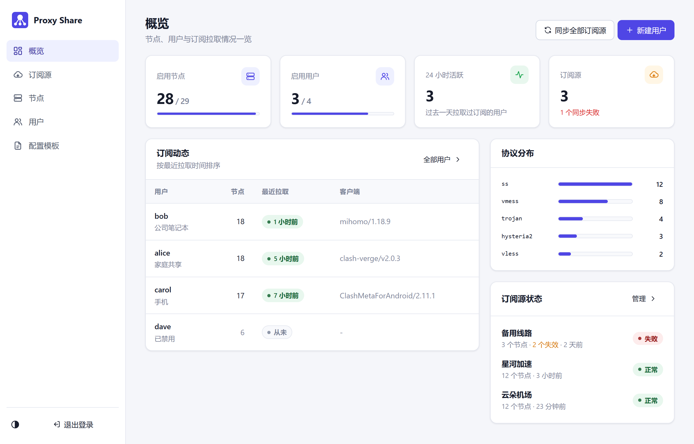
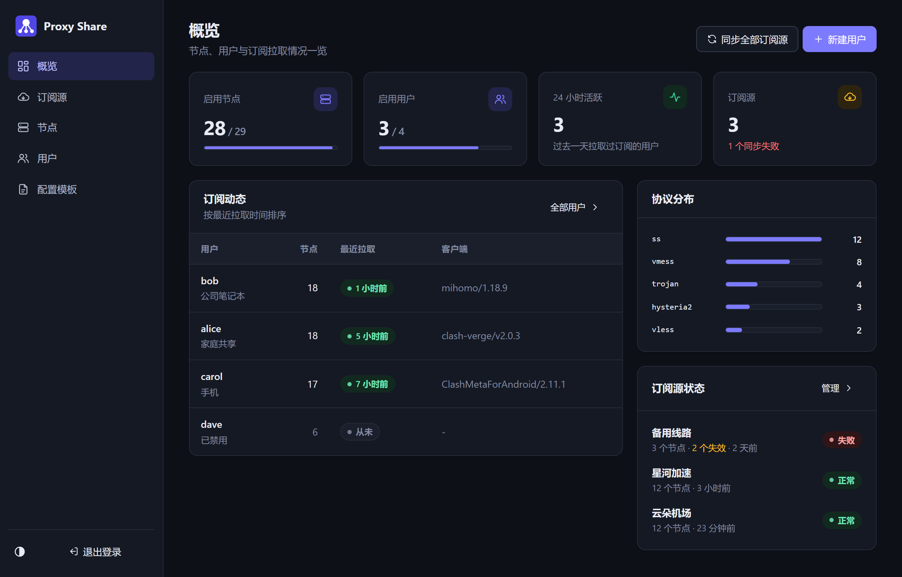
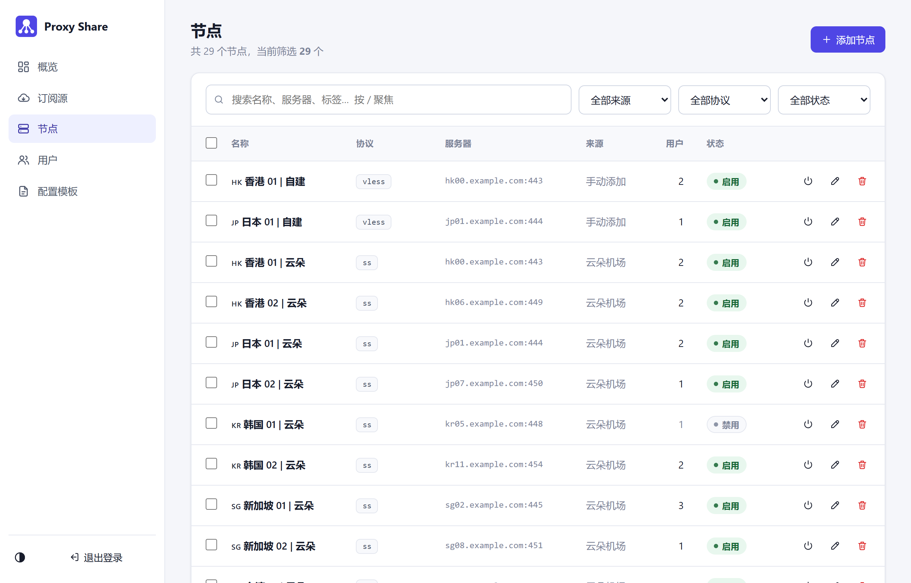
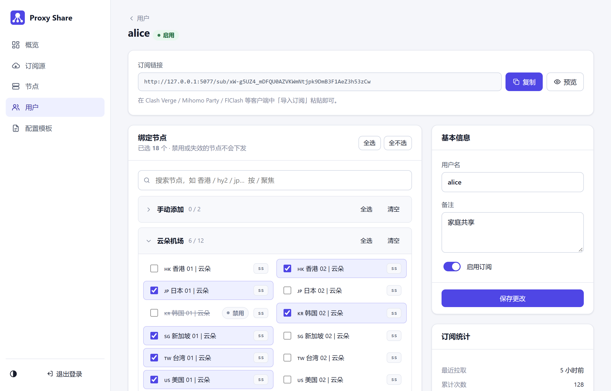
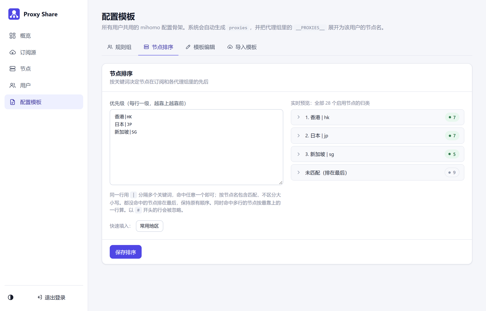
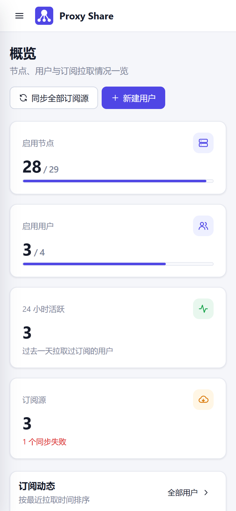
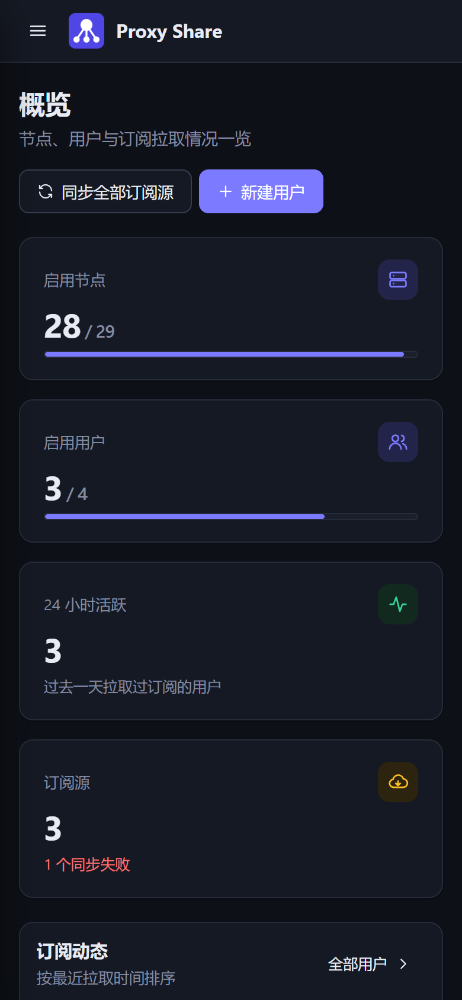

<div align="center">


# Proxy Share

自托管的 mihomo / Clash.Meta 订阅管理面板

[下载](../../releases/latest) · [功能](#功能) · [快速开始](#快速开始) · [Docker](#docker) · [配置项](#配置项)

</div>

<p align="center">
  
  
</p>

导入机场订阅或手动添加节点，按用户分配节点，为每个用户生成独立的订阅链接。单文件 Flask 应用 + SQLite，无需外部数据库，一个进程即可运行。

## 功能

**节点**
- 导入 mihomo/Clash YAML 订阅源，支持一键同步全部订阅源
- 上游更换密码或参数时，同名节点**原地更新**，用户绑定不会丢失；你在本地改过的节点名也会保留
- 上游已删除的节点自动标记为「失效」，可以筛选后批量处理
- 手动导入：多行 URI 批量导入、单个 YAML 节点、YAML 列表或整段 `proxies:` 均可
- 按来源、协议、状态筛选，即时搜索，批量启用/禁用/删除

<p align="center"></p>

**用户与订阅**
- 每个用户独立的 `/sub/<token>` 订阅链接，可随时重置 token
- 记录订阅拉取次数、最近一次的时间、IP 和客户端
- 订阅响应带 `Content-Disposition`（客户端里显示用户名）和 `profile-update-interval`，支持 gzip 压缩

<p align="center"></p>

**配置模板**
- 所有用户共用一份 mihomo 配置骨架，代理组里的 `__PROXIES__` 会展开为该用户的节点
- 可以从远程完整配置或粘贴的配置中提取模板
- **节点排序**：按关键词设定优先级（如 `香港|HK`），对 `proxies` 和所有代理组都生效，带实时预览
- **规则组默认选项**：为每个规则组设定默认选中项（DIRECT、其他组、第一个节点），自动避免循环引用；单独保存，更换模板后依然生效

<p align="center"></p>

**界面与安全**
- 响应式界面，支持浅色/深色主题，手机可用
- 全站 CSRF 防护，登录失败次数限制（15 分钟内最多 5 次），常数时间比较密码
- 仍在使用默认密码时，页面顶部会持续显示警告

<p align="center">
  
  
</p>

## 快速开始

需要 Python 3.9+。

```bash
git clone https://github.com/H-T-H/proxy_panel.git proxy-share && cd proxy-share
cp .env.example .env        # 务必修改 SECRET_KEY 和 ADMIN_PASSWORD
python3 -m venv .venv
.venv/bin/pip install -r requirements.txt
.venv/bin/python app.py
```

打开 `http://服务器IP:5000`，用 `.env` 里的账号登录。默认使用 waitress 作为生产服务器。

生成随机密钥：

```bash
python3 -c "import secrets; print(secrets.token_hex(32))"
```

## Docker

```bash
cp .env.example .env        # 修改密钥和密码
docker compose up -d --build
```

数据库保存在 `./data/app.db`。

## systemd

参考 [`deploy/proxy-share.service`](deploy/proxy-share.service)，修改其中的路径后：

```bash
sudo cp deploy/proxy-share.service /etc/systemd/system/
sudo systemctl daemon-reload
sudo systemctl enable --now proxy-share
journalctl -u proxy-share -f      # 查看日志
```

## 配置项

| 变量 | 默认值 | 说明 |
|---|---|---|
| `SECRET_KEY` | — | 会话签名密钥，**必须修改** |
| `ADMIN_USERNAME` | `admin` | 管理员用户名 |
| `ADMIN_PASSWORD` | `change-me` | 管理员密码，**必须修改** |
| `DATABASE_URL` | `sqlite:///data/app.db` | SQLAlchemy 数据库地址 |
| `HOST` / `PORT` | `0.0.0.0` / `5000` | 监听地址 |
| `THREADS` | `8` | waitress 工作线程数 |
| `TZ_OFFSET_HOURS` | `8` | 面板显示时区（相对 UTC） |
| `PROFILE_UPDATE_HOURS` | `12` | 建议客户端自动更新订阅的间隔 |
| `SESSION_DAYS` | `7` | 登录保持天数 |
| `FLASK_DEBUG` | — | 设为 `1` 时使用 Flask 开发服务器 |

## 模板说明

- 模板顶层必须是 YAML 对象。系统会自动生成 `proxies`，模板里写了也会被覆盖。
- 代理组的 `proxies` 中写 `__PROXIES__`，会展开为当前用户的全部可用节点名；没有 `proxy-groups` 时会自动生成一个 `Proxy` 组。
- 没有 `rules` 时默认为 `MATCH,Proxy`。
- 「从远程配置提取」会移除原配置的 `proxies`，并把代理组里的节点名替换为 `__PROXIES__`。注意：提取会**覆盖**当前模板；节点排序和规则组默认选项是单独保存的，不受影响。

## 安全建议

- 面板默认通过 HTTP 提供服务，登录密码和订阅链接都是明文传输。公网部署时建议放在 Nginx / Caddy 后面并启用 HTTPS，然后把 `HOST` 改为 `127.0.0.1`。反向代理需要传递 `X-Real-IP`，订阅统计和登录限流才能拿到真实 IP。
- 订阅链接等同于节点凭据，泄露后请在用户详情页「重置订阅链接」。

## 开发

```bash
.venv/bin/pip install -r requirements-dev.txt
.venv/bin/python -m pytest
```

重新生成图标（需要 Pillow）：

```bash
.venv/bin/pip install pillow
.venv/bin/python tools/make_icons.py
```

## 项目结构

```
app.py                 # 全部后端逻辑：模型、路由、订阅解析与生成
templates/             # Jinja2 页面
static/                # 样式、脚本、图标、manifest
tests/                 # pytest 测试
tools/make_icons.py    # 图标生成脚本
deploy/                # systemd 示例
docs/screenshots/      # README 截图
```

## 许可证

[MIT](LICENSE) © H-T-H
